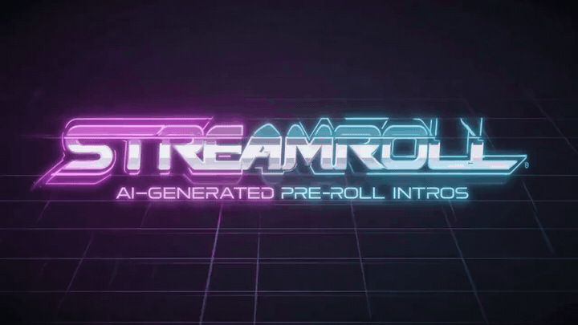

# StreamRoll

[](https://streamroll.vercel.app)
[](https://github.com/JoeKarlsson/streamroll/actions/workflows/ci.yml)
[](LICENSE)



Netflix plays its sting before every show, and Plex, Jellyfin and Emby will play
a short video before every movie too. StreamRoll makes yours from your server's
name. There's no account and nothing to pay me, and it hands you the code that
made your clip, so you can make the next one without my site.

[Try it at streamroll.vercel.app](https://streamroll.vercel.app) ·
[Read the full statement](https://www.joekarlsson.com/work/streamroll/)

## Quick start

You need a Runway API key from [dev.runwayml.com](https://dev.runwayml.com).
Runway no longer gives free trial credits, so add credits or a payment method
first.

```bash
git clone https://github.com/JoeKarlsson/streamroll.git
cd streamroll
npm install
npm run dev     # http://localhost:3000
```

Enter your key at `/setup`. It stays in your browser and rides along with each
request to the app's API routes, which pass it to Runway. The server never
stores it. `RUNWAYML_API_SECRET` (see `.env.example`) is only for the scripts in
`scripts/`; the app never reads it.

## Development

Use Node 22 or later (CI runs 22).

```bash
npm test -- --run     # Vitest unit tests (watch mode without --run)
npm run test:coverage
npm run lint          # ESLint, no warnings allowed
npx tsc --noEmit      # type check
npm run knip          # unused files, exports and dependencies
npm run build
npm run test:e2e      # Playwright: builds, serves on port 4517, runs e2e/
npm run test:links    # also checks every external link (slow, needs network)
```

The first `test:e2e` run needs a browser: `npx playwright install chromium`.
Visual baselines in `e2e/visual.spec.ts-snapshots/` exist for macOS and Linux;
CI renders the Linux ones in the Playwright container named in
`.github/workflows/ci.yml`, whose tag must match the `@playwright/test`
version.

Unit tests live in `__tests__/` and cover the API routes, `lib/`, `hooks/` and
the home page's restored-result screen; the e2e suite covers every route in a
real browser, including each readiness-review fix by its R-number. The home
page is a server component (`app/page.tsx`) around one client component,
`app/_components/home/Studio.tsx`; shared components sit in
`app/_components/`, hooks in `hooks/`, and style catalogs, model costs and the
canvas title-card renderer in `lib/`.

Audio mixing runs client-side with FFmpeg.wasm, served from the gitignored
`public/ffmpeg/`. `npm run build` fills it; under `npm run dev`, run
`node scripts/copy-ffmpeg.js` once first or the mixer has nothing to load.

`scripts/manage-tasks.mjs` checks, cancels or downloads Runway tasks by ID, and
`scripts/generate-previews.ts` (run with `npx tsx`) draws the preset preview
images with Runway. It writes 1920×1080 PNGs, while the site serves 640×360
JPEGs, so convert what it makes before committing; it spends credits.

It deploys to Vercel with `vercel`. No environment variables are needed there,
since every visitor brings their own key.

## License

MIT. See [LICENSE](LICENSE).
